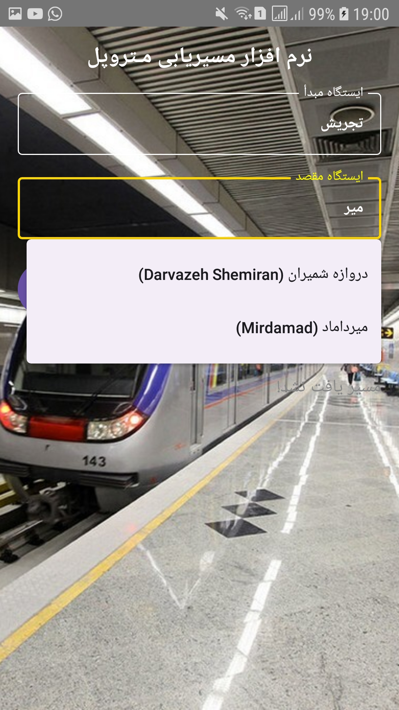
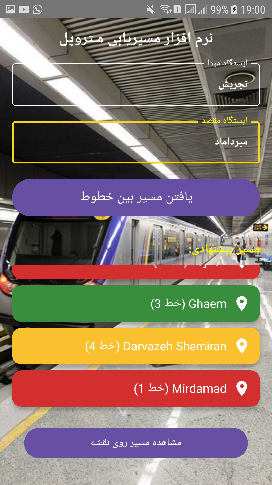
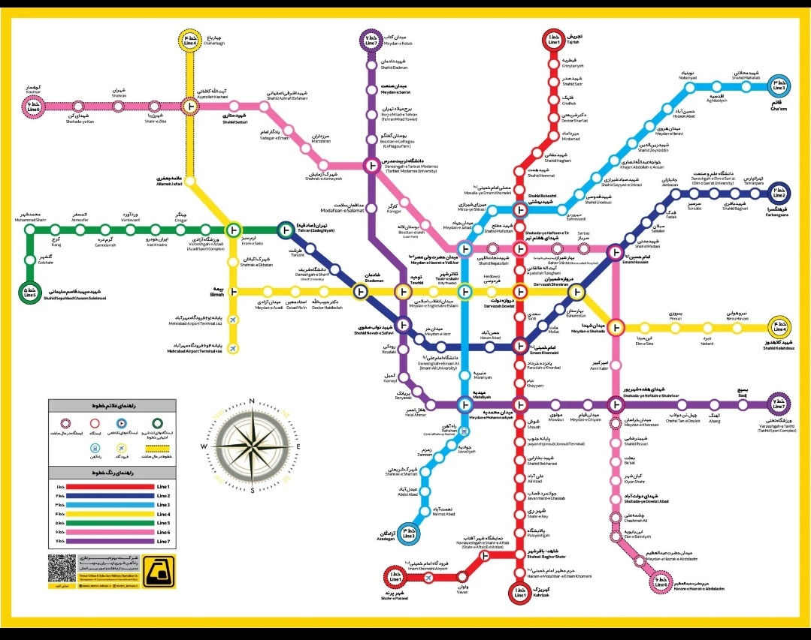

# 🚇 نرم‌افزار مسیریابی متروپل تهران

اپلیکیشن **تهران متروپل** یک نرم‌افزار اندرویدی است که مسیر بین ایستگاه‌های متروی تهران را نمایش می‌دهد.  
این برنامه با زبان **Kotlin** و معماری **Jetpack Android** توسعه داده شده است.

---

## 🧭 امکانات برنامه
- انتخاب ایستگاه مبدأ و مقصد  
- محاسبه مسیر بین خطوط مترو  
- نمایش ایستگاه‌های عبوری بین دو نقطه  
- نمایش مسیر روی نقشه متروی تهران  
- طراحی رابط کاربری مدرن با متریال دیزاین  

---

## 🧰 تکنولوژی‌ها و ابزارها
- **زبان برنامه‌نویسی:** Kotlin  
- **چارچوب:** Android Jetpack  
- **UI Framework:** XML + ViewBinding  
- **معماری:** Activity / ViewModel  
- **ابزار توسعه:** Android Studio  
- **کتابخانه‌ها:**  
  - AndroidX  
  - RecyclerView  
  - ConstraintLayout  
  - Material Components  

---

## 🖼️ تصاویر برنامه

### صفحه‌ی اصلی


### مسیر پیشنهادی


### نقشه‌ی مترو


*(توجه: تصاویر را در پوشه‌ی `images/` در کنار فایل README.md قرار دهید.)*

---

## ⚙️ نحوه اجرا

1. کلون کردن پروژه:
   ```bash
   git clone https://github.com/USERNAME/TehranMetropol.git
   ```

2. اجرای پروژه در Android Studio  
   - گزینه **File → Open** را بزنید  
   - پوشه پروژه را انتخاب کنید  
   - منتظر بمانید تا Gradle Sync کامل شود  
   - برنامه را روی شبیه‌ساز یا گوشی اجرا کنید ✅  

---

## 🗂️ ساختار پوشه‌ها
```
app/
 ├── java/com/example/tehranmetropoll/
 │    ├── MainActivity.kt
 │    ├── adapters/
 │    ├── models/
 │    └── utils/
 ├── res/
 │    ├── layout/
 │    ├── drawable/
 │    ├── values/
 │    └── mipmap/
 └── AndroidManifest.xml
```

---

## 👨‍💻 توسعه‌دهنده
طراحی و توسعه توسط **[نام شما]**  
📧 ایمیل: [ایمیل شما]

---

## 📜 مجوز
این پروژه تحت مجوز **MIT** منتشر شده است.  
می‌توانید آزادانه از آن استفاده و آن را توسعه دهید.

---

**Tehran Metropol** © 2025  
اپلیکیشن مسیریابی هوشمند برای متروی تهران 🚆
